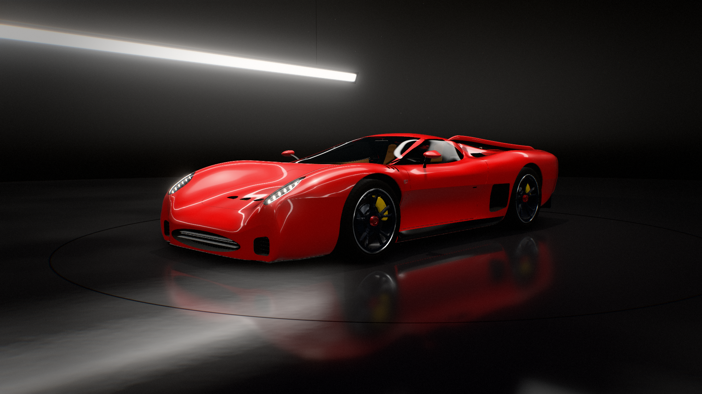
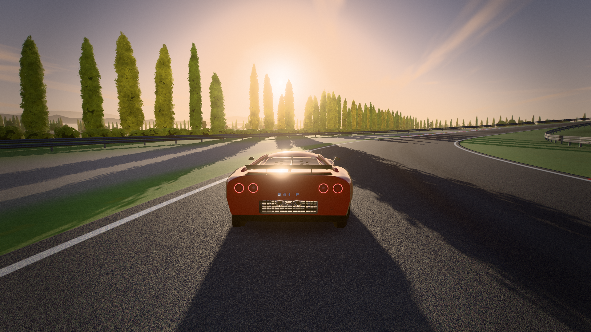
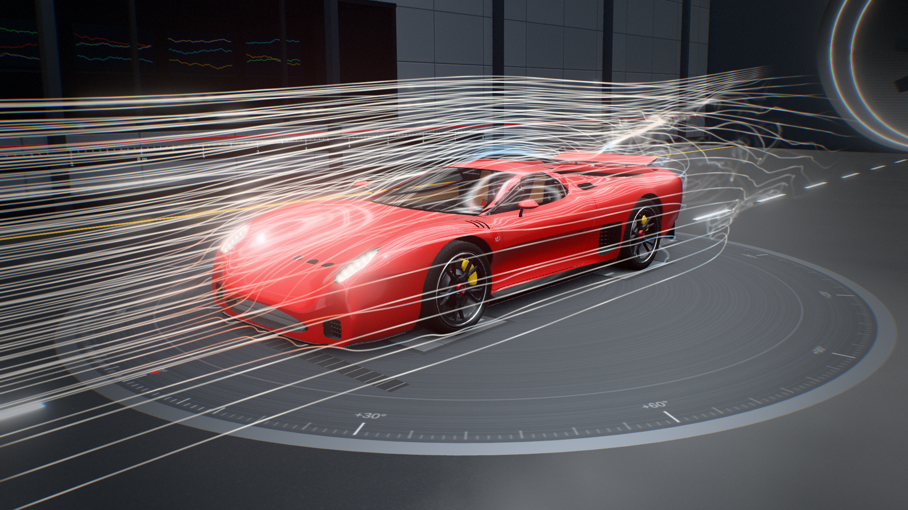

# Opus5.5 Supercar challenge — 541 P

An interactive, physically simulated 3D presentation of the 541 P, a fictional mid-engine V12 concept car. It's built in three.js and ships as a single self-contained HTML file.

**▶ Play it: https://sfxnz.github.io/supercar-challenge/**

## Venues

- **Atelier**: a studio reveal you can orbit, with hotspots, doors, mood lighting and a spec sheet.
- **Pista**: drive it on a circuit with a full vehicle-physics model (tyres, gearbox, aero, drive modes).
- **Galleria**: a wind tunnel with live flow visualisation, smoke and an active wing.

## Controls

| | |
|---|---|
| Keyboard | W/S throttle and brake/reverse · A/D steer · Space handbrake · E/Q shift · M auto/manual · 1–5 drive modes · R reset · C camera · Tab telemetry · L lights · P photo mode · hold Enter to start · Esc menu · ? help |
| Atelier | drag to orbit · wheel to zoom · double-click for a hotspot · D doors · O autorotate · N mood · 1/2/3 venues |
| Galleria | [ ] wind speed · V flow view · A wing mode · G guided sweep |
| Gamepad | RT/LT throttle and brake · LS steer · RS look · RB/LB shift · X handbrake · Y camera |
| Touch | left pad steers · GAS/FRENO pedals · −/+ paddles · hold START |

For the best experience, use a desktop browser with WebGL2 (Chrome, Edge, Safari or Firefox).

*The 541 P is fictional. No real manufacturer, brand, logo, circuit or person is depicted.*
